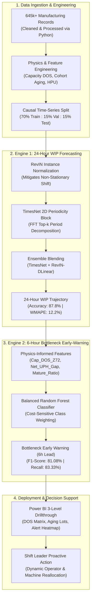
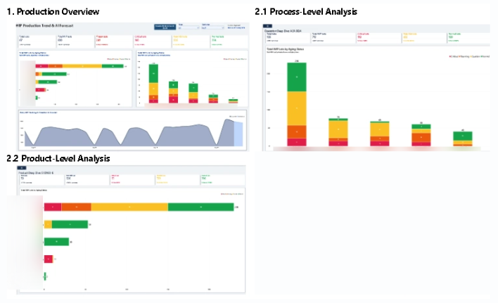
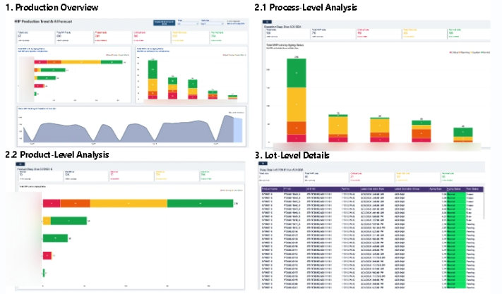

# Smart Factory: Multi-Horizon WIP Forecasting & Predictive Bottleneck Early-Warning System

[](https://www.python.org/)
[](https://pytorch.org/)
[](https://scikit-learn.org/)
[](https://powerbi.microsoft.com/)
[](LICENSE)
[]()

> **An End-to-End Industrial AI & Business Intelligence Architecture** designed for high-mix, high-volume electronics manufacturing. Transforms reactive floor firefighting into proactive decision support via **24-hour continuous WIP time-series forecasting** and **6-hour predictive bottleneck early-warning classification**.

---

## Executive Summary & Industrial Problem

In precision discrete manufacturing lines, unexpected queue build-up and Work-in-Process (WIP) starvation lead to idle machine downtime, prolonged cycle times, and missed customer ship commitments. Traditional floor management relies on static rule-based thresholds and lagging reports, identifying bottlenecks only **after** physical congestion has occurred.

### The Solution
This project engineered an end-to-end predictive intelligence pipeline deployed on over **645,000 production records**:
1. **Engine 1 (Regression):** A **24-Hour Multi-Horizon Time-Series Forecaster** leveraging **TimesNet (ICLR 2023)** and **Reversible Instance Normalization (RevIN)** to decompose complex intra-day and inter-day production cycles.
2. **Engine 2 (Classification):** A **6-Hour Bottleneck Early-Warning Classifier** using **Balanced Random Forest** and physics-informed capacity features to alert shift leaders before queue saturation occurs.
3. **Executive BI Dashboard:** An interactive **3-Level Drill-Through Power BI Dashboard** integrating actuals, AI predictions, Days-of-Supply (DOS) metrics, and aging-lot heatmaps.

---

## System Architecture



---

## Key Benchmark Results

### 1. WIP Time-Series Forecasting (24-Hour Horizon)
*Evaluated on an unseen held-out test set across all production stages:*

| Production Stage | Standalone TimesNet (WMAPE) | Ensemble Final (WMAPE) | **Forecast Accuracy (%)** |
| :--- | :---: | :---: | :---: |
| **Total WIP (Line-Wide)** | **13.84%** | **12.19% (~12.2%)** | **87.81%** |
| Process A (Kitting) | 14.78% | 14.07% | 85.93% |
| Process B (Washing) | 28.13% | 20.22% | 79.78% |
| Process C (Bonding) | 21.68% | 20.75% | 79.25% |
| Process D (Damper) | 26.76% | 26.33% | 73.67% |
| Process E (OQA) | 18.69% | 18.30% | 81.70% |
| **Overall Stage Average** | **20.65%** | **18.64%** | **81.36%** |

$$\text{Forecast Accuracy} = 100\% - \text{WMAPE}$$

---

### 2. 6-Hour Bottleneck Detection (Imbalanced Classification ~5:1)
*Cost-sensitive classification benchmark on identifying critical congestion (> 75th percentile):*

| Production Stage | Best Model | **Accuracy** | **Precision** | **Recall** | **F1-Score** | **ROC-AUC** |
| :--- | :--- | :---: | :---: | :---: | :---: | :---: |
| **Total WIP** | **Random Forest** | **93.35%** | **78.95%** | **83.33%** | **81.08%** | **94.86%** |
| Process A | Random Forest | 95.25% | 58.62% | 85.00% | 69.39% | 96.99% |
| Process B | GradBoost / RF | 95.25% | 90.00% | 76.60% | 82.76% | 94.56% |
| Process C | Random Forest | 87.66% | 63.49% | 71.43% | 67.23% | 83.02% |
| Process D | Hybrid Ensemble | 84.49% | 56.14% | 57.14% | 56.64% | 83.63% |
| Process E | Random Forest | 90.19% | 84.71% | 80.00% | 82.29% | 94.95% |
| **Line Average** | **Random Forest** | **91.14%** | **72.43%** | **74.99%** | **73.14%** | **91.34%** |

---

## Interactive Power BI Dashboard & Decision Support

The platform features an enterprise-grade 3-level drill-through dashboard bridging predictive AI outputs with daily shop-floor manufacturing operations.

### 1. Bottleneck Alert & Capacity Days-of-Supply (DOS) Analysis
Evaluates station queue length against machine standard capacities (UPH), integrates predictive bottleneck alert heatmaps, and provides multi-level drill-down by process and product mix.



### 2. WIP Production Trend & Aging Lot Tracking
Tracks line-wide WIP progression against AI forecasting trajectories, categorizing work orders into standardized aging tiers (Normal, Caution, Warning, Critical) to eliminate queue stagnation.



### Key Dashboard Capabilities:
* **Level 1 - Executive Overview:** Real-time visibility into overall line balance, active capacity load ratios, and high-risk stations.
* **Level 2 - Process & Machine Deep Dive:** Analyzes machine-level bottleneck drivers, cycle-time disparities, and capacity limits.
* **Level 3 - Product & Lot Tracking:** Identifies specific product lots exceeding aging standards to prioritize shop-floor dispatching.

---

## Standout Feature Engineering (Physics-Informed)

Rather than feeding raw piece counts, the model engineers physics-based domain features:
1. **Machine Capacity DOS & Dynamic Z-Scores (`Cap_DOS_Z72`, `Cap_DOS_Diff6_Z`):**  
   Normalizes queue length by standard daily machine capacity (`WIP / Daily_Std_Cap`) and tracks the 6-hour acceleration rate of queue accumulation.
2. **Queue Cohort Maturity & Aging (`Mature_Ratio`, `Expected_Cohort`):**  
   Distinguishes between newly arrived WIP (Fresh) and parts that have exceeded standard cycle times (Mature). Tracks upstream mature WIP ready to cascade into downstream stations.
3. **Inter-Station Bottleneck Gradient (`Net_UPH_Gap`):**  
   Calculates the speed differential (`Eff_UPH_upstream - Eff_UPH_current`). A positive gap identifies upstream pushing faster than current machines can process.
4. **Labor Workload Normalization (`Inflow_Workload_Hours`):**  
   Translates raw quantities into standard man-hours (`Qty * HPU`) across distinct product mixes.

---

## Tech Stack & Tooling

* **Programming & Core:** Python 3.10+, NumPy, Pandas, Scipy
* **Deep Learning (Time-Series):** PyTorch, TimesNet Architecture, FFT Transforms, RevIN Normalization
* **Machine Learning:** Scikit-Learn (Random Forest, Extra Trees, HistGradientBoosting, Logistic Regression)
* **Data Visualization & BI:** Power BI Desktop (DAX, Star Schema, 3-Level Drillthrough), Seaborn, Matplotlib

---

## Quickstart & Reproduction

### 1. Clone the Repository
```bash
git clone https://github.com/<your-username>/smart-factory-wip-bottleneck-ai.git
cd smart-factory-wip-bottleneck-ai
```

### 2. Install Dependencies
```bash
pip install -r requirements.txt
```

### 3. Generate Demonstration Dataset
```bash
python data/generate_mock_data.py
```

### 4. Train & Evaluate the Bottleneck Classifier
```bash
python src/train_classifier.py
```

### 5. Train & Evaluate the TimesNet Forecaster
```bash
python src/train_timesnet.py
```

---

## Confidentiality & Data Anonymization

> **Notice:** In accordance with industrial non-disclosure agreements (NDA):
> * All proprietary customer identifiers, part numbers, job numbers, and line nomenclature have been strictly anonymized (e.g., *Customer A–C*, *Process A–E*).
> * The repository includes a synthetic data generator mimicking real production distributions without revealing confidential piece counts or commercial targets.
> * Evaluated metrics are reported solely as standardized percentages, ratios, and relative indices.

---

## Author

**Chakrapong Pindontree**  
*Data Science Student, Silpakorn University*  
*Cooperative Education Trainee in Precision Manufacturing Analytics*  
* Email: [chakrapong.pindontre@gmail.com](mailto:chakrapong.pindontre@gmail.com)  
* Phone: +66 82-978-2944  
